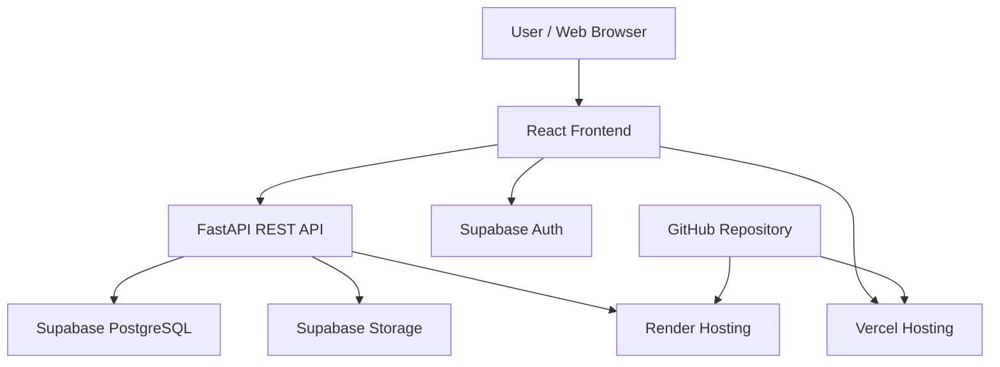

# Online Hobby & Skills Tracker with Community Sharing

A cloud-native web application that helps users organize their hobbies, develop skills, set learning goals, track practice sessions, celebrate milestones, and share their progress with a community.

The application combines personal progress tracking, achievement management, community interaction, and cloud-based services into a single platform.

---

## Features

### Hobby & Skills Management
- **Hobby Management** — Create, edit, and organize hobbies by category.
- **Skill Tracking** — Add skills to hobbies and track proficiency levels.
- **Proficiency Levels** — Beginner, Intermediate, Advanced, and Expert.
- **Personal Organization** — Manage hobbies and associated skills in one place.

### Goals & Practice Tracking
- **Goal Setting** — Create goals associated with hobbies and define target practice hours.
- **Goal Management** — Manage goal status (Pending, In Progress, Completed, and Cancelled).
- **Practice Sessions** — Record practice duration, dates, and notes.
- **Progress Tracking** — Monitor learning progress through practice records and analytics.

### Milestone & Achievement System
- **Milestone Creation** — Create milestones associated with learning goals.
- **Automatic Unlocking** — Associated milestones unlock automatically when a goal is marked as Completed.
- **Achievement Tracking** — View achieved and pending milestones.
- **Achievement Dates** — Track when milestones are unlocked.
- **Goal-based Progress** — Organize achievements around individual learning goals.

### Community & Social Features
- **Community Feed** — Discover posts shared by other users.
- **Post Creation** — Share learning experiences, achievements, and progress.
- **Likes** — Like and unlike community posts.
- **Comments** — Interact with posts through comments.
- **Public and Private Posts** — Control post visibility.
- **Profiles** — Customize your display name and bio.
- **Search** — Search across supported hobbies, skills, posts, and profiles.

### Dashboard & Analytics
- Track hobbies and skills.
- Monitor practice activity.
- Review goal progress.
- View learning statistics.
- Monitor milestones and achievements.

---

## Technology Stack

| Layer | Technology |
|---|---|
| Frontend | React 19, Vite 8, JavaScript |
| Styling | Tailwind CSS v4 |
| Charts & Analytics | Recharts |
| Routing | React Router |
| HTTP Client | Axios |
| Backend | Python 3.11, FastAPI |
| API Validation | Pydantic |
| ORM | SQLAlchemy |
| Authentication | Supabase Auth |
| Authentication Tokens | JWT |
| Database | Supabase PostgreSQL |
| Cloud Storage | Supabase Storage |
| Frontend Hosting | Vercel |
| Backend Hosting | Render |
| Version Control | Git, GitHub |
| CI/CD | GitHub Actions |
| Testing | Pytest, Vitest, React Testing Library |

---

## Architecture

The application follows a client-server architecture with cloud-hosted database, authentication, and storage services.



### Architecture Overview

- **React frontend** — Provides the user interface and communicates with the backend through REST APIs.
- **FastAPI backend** — Handles API requests, validation, authorization, business logic, and database operations.
- **Supabase Auth** — Handles user authentication and access tokens.
- **Supabase PostgreSQL** — Stores user profiles, hobbies, skills, goals, practice sessions, milestones, and community data.
- **Supabase Storage** — Provides cloud object storage for supported uploads.
- **Vercel** — Hosts the frontend application.
- **Render** — Hosts the backend API.
- **GitHub** — Stores source code and supports version control and deployment workflows.

---

## Application Workflow

### 1. Manage Hobbies and Skills

1. Register or log in.
2. Create hobbies with a name, category, and description.
3. Edit or manage hobbies.
4. Add skills to hobbies.
5. Assign proficiency levels to skills.

### 2. Create Learning Goals

1. Navigate to the Goals section.
2. Create a new goal.
3. Select the associated hobby.
4. Enter the goal title and description.
5. Set the target practice hours.
6. Manage the goal status as progress is made.

### 3. Record Practice Sessions

1. Navigate to the Practice Sessions section.
2. Select the relevant hobby and skill.
3. Record the practice duration.
4. Enter the practice date and notes.
5. Save the session.
6. Review accumulated practice and analytics.

### 4. Unlock Milestones

1. Create milestones associated with learning goals.
2. Work toward the goal through practice and learning.
3. Mark the goal as Completed when finished.
4. Associated milestones are automatically unlocked.
5. View achievements and achievement dates in the Milestones section.

### 5. Share Progress

1. Navigate to the Community section.
2. Create a post with a title and content.
3. Select the appropriate visibility, if available.
4. Share your learning progress.
5. Like, unlike, and comment on community posts.

---

## Project Structure

```text
online-hobby-and-skills-tracker-with-community-sharing-cloud/
│
├── .github/
│   └── workflows/
│
├── backend/
│   ├── app/
│   │   ├── api/
│   │   │   ├── analytics.py
│   │   │   ├── community.py
│   │   │   ├── goals.py
│   │   │   ├── hobbies.py
│   │   │   ├── milestones.py
│   │   │   ├── profiles.py
│   │   │   ├── search.py
│   │   │   ├── sessions.py
│   │   │   ├── skills.py
│   │   │   └── uploads.py
│   │   │
│   │   ├── core/
│   │   │   ├── auth.py
│   │   │   ├── config.py
│   │   │   └── database.py
│   │   │
│   │   ├── models/
│   │   │   └── models.py
│   │   │
│   │   ├── repositories/
│   │   ├── schemas/
│   │   │   └── schemas.py
│   │   │
│   │   ├── services/
│   │   └── main.py
│   │
│   ├── tests/
│   ├── requirements.txt
│   └── .env.example
│
├── frontend/
│   ├── public/
│   ├── src/
│   │   ├── assets/
│   │   ├── components/
│   │   ├── contexts/
│   │   ├── hooks/
│   │   ├── layouts/
│   │   ├── pages/
│   │   ├── services/
│   │   ├── utils/
│   │   ├── __tests__/
│   │   ├── App.jsx
│   │   ├── index.css
│   │   └── main.jsx
│   │
│   ├── package.json
│   ├── package-lock.json
│   ├── vite.config.js
│   └── .env.example
│
├── supabase/
│   ├── migrations/
│   │   └── 0001_initial_schema.sql
│   └── MIGRATION_GUIDE.md
│
├── docs/
│   └── database-schema.md
│
├── scripts/
│
├── .gitignore
├── README.md
└── START_FULL_STACK.md
```

---

## Prerequisites

The following tools are required to run the application locally on Windows 11.

| Tool | Version | Download |
|---|---|---|
| Node.js | 18+ | https://nodejs.org |
| Python | 3.11+ | https://www.python.org/downloads/ |
| Git | 2.x+ | https://git-scm.com |
| Supabase Account | — | https://supabase.com |

Docker Desktop and the Supabase CLI are optional for local Supabase development and container-based workflows.

---

## Installation & Setup

### 1. Clone the Repository

```powershell
git clone https://github.com/Sanjay20-AS/online-hobby-skills-tracker-with-cloud.git

cd online-hobby-and-skills-tracker-with-community-sharing-cloud
```

### 2. Configure the Database

1. Create or use an existing Supabase project.
2. Open the Supabase SQL Editor.
3. Execute the migration file:

```text
supabase/migrations/0001_initial_schema.sql
```

4. Verify the required tables and database policies are created.
5. Configure the required Supabase credentials.

> If the database has already been initialized, do not execute the migration again without checking its contents and current database state.

---

## Frontend Setup

### 1. Navigate to the frontend directory

```powershell
cd frontend
```

### 2. Install dependencies

```powershell
npm install
```

### 3. Configure environment variables

Create the frontend `.env` file from the example:

```powershell
Copy-Item .env.example .env
```

Edit `frontend/.env` and configure the required values:

```env
VITE_API_BASE_URL=http://localhost:8000
VITE_SUPABASE_URL=YOUR_SUPABASE_PROJECT_URL
VITE_SUPABASE_ANON_KEY=YOUR_SUPABASE_PUBLISHABLE_OR_ANON_KEY
```

### 4. Start the frontend

```powershell
npm run dev
```

The frontend will be available at:

http://localhost:5173

### Frontend Commands

| Command | Description |
|---|---|
| `npm run dev` | Start the development server |
| `npm run build` | Build the production frontend |
| `npm run preview` | Preview the production build |
| `npm run test` | Run frontend tests |
| `npm run test:watch` | Run tests in watch mode |

---

## Backend Setup

### 1. Navigate to the backend directory

From the project root:

```powershell
cd backend
```

### 2. Create the Python virtual environment

```powershell
py -3.11 -m venv .venv
```

### 3. Activate the virtual environment

```powershell
.\.venv\Scripts\Activate.ps1
```

If PowerShell blocks script execution, run:

```powershell
Set-ExecutionPolicy -ExecutionPolicy RemoteSigned -Scope CurrentUser
```

Restart or reopen PowerShell if necessary and activate the environment again.

### 4. Install dependencies

```powershell
pip install -r requirements.txt
```

### 5. Configure environment variables

Create the backend `.env` file:

```powershell
Copy-Item .env.example .env
```

Edit `backend/.env` and configure the required settings:

```env
APP_ENV=development
APP_NAME=Online Hobby and Skills Tracker
API_V1_PREFIX=/api/v1

DATABASE_URL=YOUR_DATABASE_CONNECTION_STRING

SUPABASE_URL=YOUR_SUPABASE_PROJECT_URL
SUPABASE_ANON_KEY=YOUR_SUPABASE_PUBLISHABLE_OR_ANON_KEY

CORS_ORIGINS=http://localhost:5173
```

### 6. Start the backend

```powershell
python -m uvicorn app.main:app --reload --app-dir .
```

The backend will be available at:

- **Base URL:** http://localhost:8000
- **Health check:** http://localhost:8000/health
- **Swagger API documentation:** http://localhost:8000/api/v1/docs
- **ReDoc documentation:** http://localhost:8000/api/v1/redoc

---

## Running the Application

The frontend and backend run independently.

### Terminal 1 — Backend

```powershell
cd backend

.\.venv\Scripts\Activate.ps1

python -m uvicorn app.main:app --reload --app-dir .
```

### Terminal 2 — Frontend

```powershell
cd frontend

npm run dev
```

Open the frontend in your browser:

http://localhost:5173

---

## REST API

The application exposes REST API endpoints through FastAPI.

### Health

| Method | Endpoint | Description |
|---|---|---|
| GET | `/health` | Check backend availability |

### Profiles

| Method | Endpoint | Description |
|---|---|---|
| GET | `/api/v1/profiles/me` | Retrieve the current user's profile |
| PUT | `/api/v1/profiles/me` | Update the current user's profile |

### Hobbies

| Method | Endpoint | Description |
|---|---|---|
| GET | `/api/v1/hobbies` | Retrieve hobbies |
| POST | `/api/v1/hobbies` | Create a hobby |
| PUT | `/api/v1/hobbies/{hobby_id}` | Update a hobby |
| DELETE | `/api/v1/hobbies/{hobby_id}` | Delete a hobby |

### Skills

| Method | Endpoint | Description |
|---|---|---|
| GET | `/api/v1/skills` | Retrieve skills |
| POST | `/api/v1/skills` | Create a skill |

### Goals

| Method | Endpoint | Description |
|---|---|---|
| GET | `/api/v1/goals` | Retrieve goals |
| POST | `/api/v1/goals` | Create a goal |
| PUT | `/api/v1/goals/{goal_id}` | Update a goal |

### Practice Sessions

| Method | Endpoint | Description |
|---|---|---|
| GET | `/api/v1/sessions` | Retrieve practice sessions |
| POST | `/api/v1/sessions` | Record a practice session |

### Milestones

| Method | Endpoint | Description |
|---|---|---|
| GET | `/api/v1/milestones` | Retrieve milestones |
| POST | `/api/v1/milestones` | Create a milestone |

### Community

| Method | Endpoint | Description |
|---|---|---|
| GET | `/api/v1/feed` | Retrieve community feed |
| POST | `/api/v1/posts` | Create a community post |
| POST | `/api/v1/posts/{post_id}/likes` | Like a post |
| DELETE | `/api/v1/posts/{post_id}/likes` | Unlike a post |
| POST | `/api/v1/posts/{post_id}/comments` | Add a comment |

### Search

| Method | Endpoint | Description |
|---|---|---|
| GET | `/api/v1/search?q={query}` | Search supported content |

### Analytics

| Method | Endpoint | Description |
|---|---|---|
| GET | `/api/v1/analytics/overview` | Retrieve analytics overview |

> Additional endpoints and request/response schemas are available through the FastAPI Swagger documentation.

---

## Authentication & Security

The application incorporates security mechanisms to protect user data and access.

- **Supabase Authentication** — Authentication and user identity management.
- **JWT Authentication** — Backend API requests use authentication tokens.
- **Protected Routes** — Authenticated users access protected frontend pages.
- **Authorization** — Backend checks user ownership and permissions.
- **Row Level Security (RLS)** — PostgreSQL policies restrict access to protected data.
- **Ownership Validation** — Database and backend safeguards protect user-owned records.
- **Private Storage** — Supported storage operations use controlled access.
- **CORS Configuration** — Restricts browser-based API access to configured origins.
- **Environment Variables** — Credentials and configuration are kept outside source code.

### Security Warning

**Never commit real credentials, API keys, passwords, or secrets to this repository.**

- Keep `.env` files local only.
- Only `.env.example` files with placeholder values should be committed.
- Never expose Supabase service-role keys in frontend code.
- Never include private database connection strings in public documentation.
- Use least-privilege access and validate authorization on the backend.

---

## Environment Variables

### Frontend (`frontend/.env`)

| Variable | Description |
|---|---|
| `VITE_API_BASE_URL` | Backend API base URL |
| `VITE_SUPABASE_URL` | Supabase project URL |
| `VITE_SUPABASE_ANON_KEY` | Supabase publishable or anon key |

### Backend (`backend/.env`)

| Variable | Description |
|---|---|
| `APP_ENV` | Application environment |
| `APP_NAME` | Application name |
| `API_V1_PREFIX` | API version prefix |
| `DATABASE_URL` | PostgreSQL connection string |
| `SUPABASE_URL` | Supabase project URL |
| `SUPABASE_ANON_KEY` | Supabase publishable or anon key, where required |
| `CORS_ORIGINS` | Allowed frontend origins |

> The actual required configuration depends on the application implementation and deployment environment. Refer to the `.env.example` files.

---

## Deployment

The application is designed to use cloud services for hosting and data management.

| Component | Cloud Service |
|---|---|
| Frontend | Vercel |
| Backend REST API | Render |
| PostgreSQL Database | Supabase |
| Authentication | Supabase Auth |
| Object Storage | Supabase Storage |
| Source Code | GitHub |

Deployment requires configuring environment variables, production CORS settings, authentication URLs, and cloud service access.

---

## Git Security & `.gitignore`

The repository `.gitignore` excludes sensitive files and generated artifacts, including:

- `.env` files
- Python virtual environments
- `node_modules`
- Frontend build outputs
- Python caches and compiled files
- IDE-specific files
- OS-specific files

The repository tracks `.env.example` files containing configuration placeholders.

---

## Testing

The project includes testing infrastructure for the frontend and backend.

### Backend Testing

```powershell
cd backend

.\.venv\Scripts\Activate.ps1

pytest
```

### Frontend Testing

```powershell
cd frontend

npm run test
```

### Production Build

```powershell
cd frontend

npm run build
```

Testing covers application components, API behavior, authentication-related functionality, and selected application flows.

---

## Future Enhancements

Potential future improvements include:

- Enhanced analytics and visual progress reports.
- Advanced community interactions.
- Improved search and filtering.
- Additional achievement and milestone types.
- Image preview and media enhancements.
- Automated end-to-end testing.
- Expanded CI/CD automation.
- More comprehensive security and authorization testing.

---

## Repository

GitHub Repository:

https://github.com/Sanjay20-AS/online-hobby-skills-tracker-with-community-sharing-cloud

---

## License

No license has been specified yet. Unless a license is added to the repository, the source code is subject to the default copyright restrictions.

---

**Built with React, FastAPI, PostgreSQL, Supabase, and cloud computing technologies.**